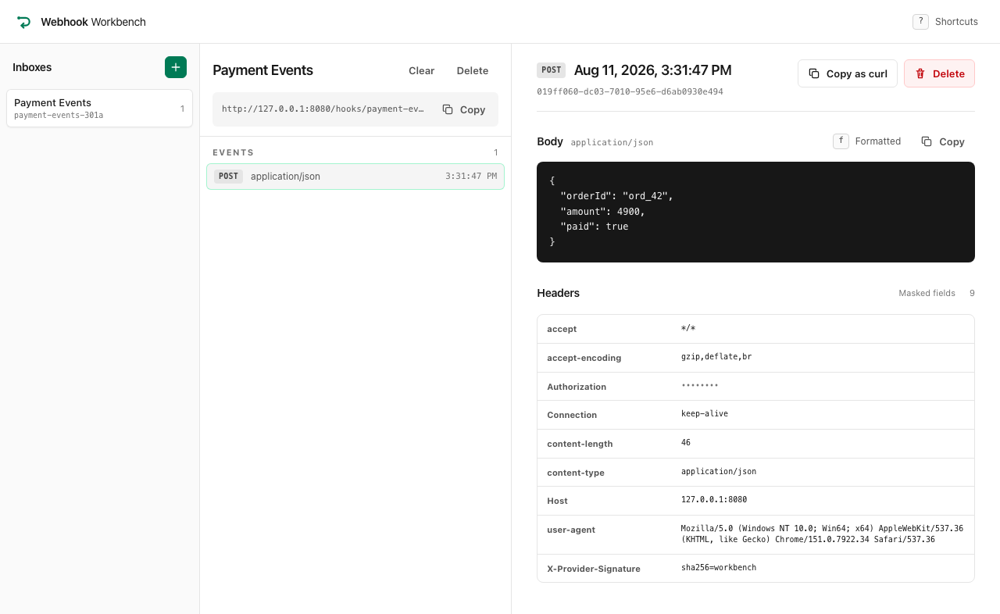

<div align="center">
  <h1>
    
    <br>
    Webhook Workbench
  </h1>
  <p>
    Catch webhooks locally, inspect them, and replay them with curl.
  </p>
</div>

## Quick start

```bash
docker compose up --build
```

Open [http://localhost:8080](http://localhost:8080), create an inbox, and hit **Copy** for its endpoint. Paste that URL as `$ENDPOINT` below (or inline it in the curl).

```bash
curl -X POST "$ENDPOINT" \
  -H 'Content-Type: application/json' \
  -H 'X-Example-Signature: sha256=demo' \
  -d '{"event":"payment.completed","amount":4200}'
```

It shows up in the inbox right away. Each inbox has its own URL. Unknown ones return `404`.



Any method, any content type, broken JSON, empty body: the request is stored exactly as it arrived. Copy any capture as a ready-to-run `curl` and point it at your own handler to replay it.

The URL tracks what you're looking at (`/inboxes/{inboxId}/events/{eventId}`), so reloads, shared links, and the back button all work as you'd expect.

## Masking secrets

Press `m` before you share your screen.

Values start masked. While anything is revealed, the header shows **Revealed**. The raw request in the database is never changed. Masking is display-only.

Edit the field list under **Masked fields** (above the headers). Matching is case-insensitive and works everywhere:

| Where | Example |
| --- | --- |
| Header names | `Authorization`, `X-Auth-Token` |
| JSON keys (any depth) | `{"card":{"token":…}}` |
| Form field names | `token=tok_live_1` |
| XML elements and attributes | `<card>…</card>`, `token="…"` |

Name a wrapper and everything under it is hidden too, so `card` covers the whole subtree and the element's attributes. Unstructured bodies are left as they are.

The field list is shared across the instance, so teammates see the same masks. Pressing `m` only affects your tab.

## Formatted vs raw body

Press `f` to switch between a readable view and the exact bytes that arrived.

JSON, form data, and XML get indented when we can. Use the raw view when a signature depends on whitespace, or when the bug *is* the whitespace. If there's nothing useful to format, the toggle stays hidden.

Masking and formatting are independent, so "as sent" is the stored bytes whenever nothing was masked. The exception is JSON that had something masked: it has to be rebuilt from a parse and loses the original whitespace. Hit `m` first if you need the exact original.

## Sharing with a team

One instance holds one set of inboxes, which is handy when a few people are debugging the same delivery.

On localhost you don't need a token. Before you expose it elsewhere:

```bash
WORKBENCH_ACCESS_TOKEN=$(openssl rand -hex 24) docker compose up
```

The UI asks once and remembers. Scripts send `Authorization: Bearer <token>`.

`/hooks` stays open so providers can deliver without a token. The token only protects who can *read* captures.

## Running it

| | Web | Server | MySQL |
| --- | --- | --- | --- |
| Local | Vite `:5173` | `spring-boot:run` | your install |
| Hybrid | Vite `:5173` | `spring-boot:run` | container |
| Container | inside the JAR | container | container |

You'll want a JDK matching `server/pom.xml`, Node matching `engines` in `web/package.json`, pnpm, Docker if you use containers, and MySQL 9.7 LTS for a fully local setup.

**Local.** Set up the database once:

```bash
mysql -u root -e "CREATE DATABASE IF NOT EXISTS webhook_workbench;
  CREATE USER IF NOT EXISTS 'workbench'@'localhost' IDENTIFIED BY 'workbench';
  GRANT ALL PRIVILEGES ON webhook_workbench.* TO 'workbench'@'localhost';"
```

Then two terminals:

```bash
./server/mvnw -f server/pom.xml spring-boot:run  # API on :8080
pnpm --dir web dev                               # UI on :5173
```

**Hybrid.** The same two commands, but start MySQL with `docker compose up --detach mysql`.

**Container.** `docker compose up --build` (or `up` if the image is already built). `docker compose down --volumes` wipes the database too.

Use [localhost:5173](http://localhost:5173) for local/hybrid, [localhost:8080](http://localhost:8080) for the full container stack.

Vite proxies `/api`, `/hooks`, and `/actuator`, so the browser talks to one origin in dev just like in production. Flyway applies the schema on startup.

UI changes hot-reload. With DevTools on the classpath, an IDE rebuild restarts the server. From a plain terminal, restart `spring-boot:run` yourself.

## Native binary

Same app, compiled ahead of time instead of running on the JVM.

With a GraalVM Community JDK on `JAVA_HOME`:

```bash
pnpm --dir web build
./server/mvnw -f server/pom.xml -Pnative -DskipTests native:compile
./server/target/webhook-workbench
```

If reachability metadata fails to resolve, your JDK is older than `native-maven-plugin` expects. Upgrade it and try again.

As a container (native image builds need plenty of memory for Docker):

```bash
APP_DOCKER_TARGET=native-runtime docker compose up --build
```

## Developing

```bash
pnpm --dir web format:check
pnpm --dir web lint
pnpm --dir web test
pnpm --dir web build
./server/mvnw -f server/pom.xml --batch-mode verify
```

`lint` covers TypeScript diagnostics too, so there's no separate typecheck step. It also runs `react/react-compiler` with `reportAllBailouts`, which lists every place the compiler skipped memoizing.

Wire types come from Java records annotated `@WireType` and land in `web/src/api/generated.ts`:

```bash
./scripts/generate-api-types.sh
```

`ApiTypeContractTest` fails `verify` if the committed file drifts from the records. Drop a field on the server and the client won't compile.

Against a running instance:

```bash
./scripts/smoke-application.sh http://127.0.0.1:8080
BASE_URL=http://127.0.0.1:8080 pnpm --dir web test:e2e
```

CI runs web and server jobs in parallel, then builds and smokes the image. Native compilation is a separate manual workflow.

## Configuration

Defaults work with no `.env` at all. See [`.env.example`](.env.example) for the full list, including DB credentials and ports. These change behavior:

| Variable | What it does |
| --- | --- |
| `WORKBENCH_ACCESS_TOKEN` | Guards `/api` and the UI. Unset leaves the instance open. |
| `WORKBENCH_RETENTION_MAX_EVENTS_PER_INBOX` | Older events past this count are pruned on capture. |
| `WORKBENCH_MAX_BODY_SIZE` | Larger bodies get a 413. |
| `WORKBENCH_MAX_PAGE_SIZE` | Max page size a client can request. |
| `WORKBENCH_STREAM_HEARTBEAT_INTERVAL` | How often an idle SSE stream pings. |
| `APP_DOCKER_TARGET` | `native-runtime` builds the AOT image instead. |

## License

The source code is available under the
[zlib License](https://www.zlib.net/zlib_license.html).
